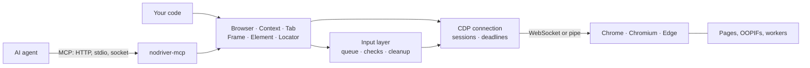
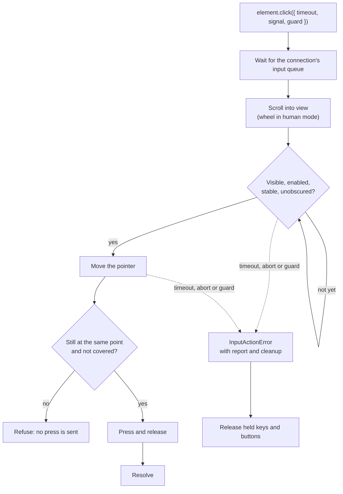
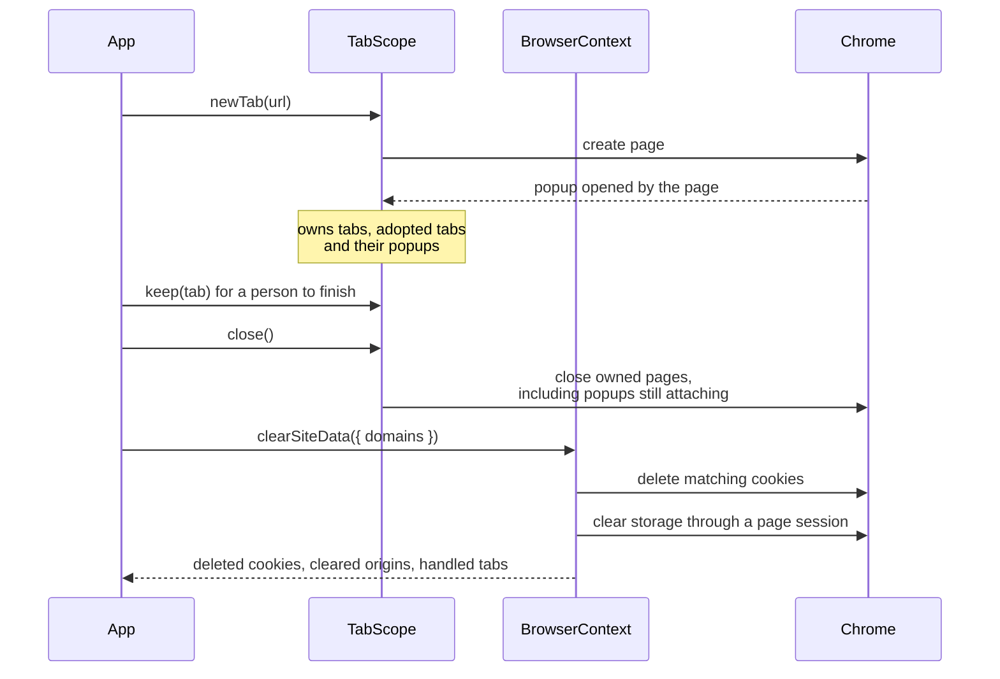
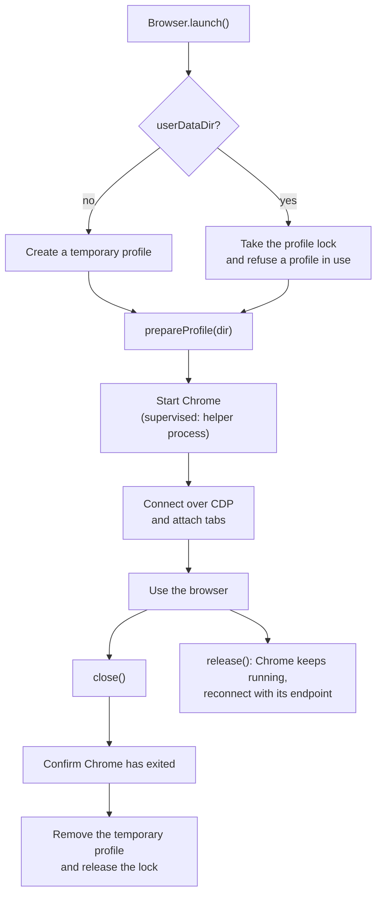

# nodriver-ts

TypeScript redesign of [nodriver](https://github.com/ultrafunkamsterdam/nodriver): Chrome, Chromium and Edge automation over the Chrome DevTools Protocol (CDP), with no WebDriver and no `Runtime.enable`, plus a built-in [Model Context Protocol](https://modelcontextprotocol.io/specification/2026-07-28) server for agents.

[简体中文](README.zh-CN.md)

If you like nodriver-ts, please give it a ⭐ on [GitHub](https://github.com/jaykwok/nodriver-ts): it helps others find the project and keeps it going.

- **Quiet CDP.** The library never sends `Runtime.enable`, `Runtime.addBinding`, `Console.enable` or `Debugger.enable`, and never falls back to them. It finds the main world through the frame's document and `DOM.resolveNode`, injects nothing into the page, and leaves Chrome's sandbox and site isolation on.
- **Frames and shadow DOM.** Same-process and out-of-process iframes (OOPIF), nested ones included, each use the right CDP session. Queries pierce open and closed shadow roots.
- **Input.** Clicks wait until the target is visible, stable and unobscured, and actions are never replayed. An optional seeded `human` policy adds pointer paths, key-event typing and wheel scrolling.
- **MCP for agents.** Tools act on stable element refs (`e12`) from an indented accessibility snapshot and report what an action caused: navigations, new tabs, dialogs. HTTP leases keep browser state across requests and reconnects. Streamable HTTP, stdio and a local socket share one implementation.

## How it fits together



Your code and the MCP server use the same objects. Every command goes through one connection, which routes it to the browser, page or frame session it belongs to, applies the caller's timeout and signal, and names that session in a `ProtocolError`.

> No automation framework is undetectable. nodriver-ts removes the common CDP and WebDriver tells, but it does not promise that any site will let you through. See [automation traces](#automation-traces).

## Requirements

- Node.js 24.22.0 or newer.
- A local Chrome, Chromium or Edge. It is found automatically on Windows, macOS and Linux, including on `PATH`; otherwise set `CHROME_PATH` or `executablePath`.
- A display for the default headful mode. On servers and in CI, pass `headless: true` (`--headless` for the MCP server); on Linux, `virtualDisplay: true` (`--virtual-display`) runs headful Chrome on its own Xvfb server instead. On Linux, run as a normal user with Chrome's shared libraries installed: the library never adds `--no-sandbox`. Headful mode on WSL needs WSLg or another display server.

Supported platforms are listed in [docs/support.md](docs/support.md).

## Quick start

```sh
npm install nodriver-ts
```

```js
import { Browser } from 'nodriver-ts';

await using browser = await Browser.launch({ headless: true }); // closed at the end of scope
const tab = await browser.newTab('https://example.com');
console.log(await (await tab.waitForSelector('h1')).text());
await tab.screenshot({ path: 'page.png', fullPage: true });
```

- **Elements that re-render.** `tab.locator('#save')` queries again before each action, so a click reaches the current button after a single-page app redraws it. Input that was already sent is never repeated.
- **Requests in the page.** `tab.fetch('/api/me', { responseType: 'json' })` runs `fetch()` with the page's cookies, origin and proxy. A timeout or abort also aborts the request in the page.
- **Evaluation.** `tab.evaluate()` runs in the page's main world, or in an isolated world with `{ world: 'isolated' }`. Functions are serialized into the page.
- **Frames.** `tab.frames` lists every frame, OOPIFs included. Queries never cross frames silently.
- **Contexts and proxies.** `browser.newContext({ proxy })` isolates cookies and storage, and supports authenticated HTTP(S) and SOCKS upstream proxies.
- **Network.** `tab.network.route()` intercepts and fulfils requests, `authenticate()` answers auth challenges and `responses` subscribes to responses. `Network.enable` is sent only when you subscribe to responses, call `enable()` or set headers, cache or offline mode.
- **Human input.** `Browser.launch({ inputPolicy: { mode: 'human' } })` applies to every tab and popup, and `tab.setInputPolicy()` changes one tab. It turns on reproducible pointer paths, key events for US-layout characters and wheel scrolling; other text, such as CJK or emoji, is inserted with `insertText`. `fill()` replaces a value with one insertion, `type(text, { replace: true })` types over it key by key. See [input](docs/input.md).
- **Existing browsers.** `Browser.connect({ endpoint })` attaches to every tab, or, with `attach: 'created'`, only to the tabs this client opens and their popups. `close()` then only disconnects. A remote debugging endpoint gives full control of the browser, so restrict access to it.
- **Handoff.** Launched with `detached: true` over WebSocket, Chrome can outlive this process: `browser.release()` returns an endpoint to reconnect to later. Add `supervised: true` to have a helper end Chrome if the host dies before releasing it. See [browser handoff](docs/browser-handoff.md) and [supervised launch](docs/lifecycle-ownership-design.md).
- **Raw sessions.** `attach: 'none'` discovers targets without creating tabs, and `attachSession()` returns independent sessions with an explicit lifecycle. See [raw sessions](docs/raw-sessions.md).
- **Diagnostics.** `trace` (or `NODRIVER_TRACE=1`) records each command's method, session, duration and error code, never its parameters or results. `browser.drain()` waits for late replies, and launch failures report their stage and process state. See [startup diagnostics](docs/startup-diagnostics.md).
- **Tests without Chrome.** `nodriver-ts/testing` provides `ScriptedChrome`, a scripted CDP peer behind real Browser, Tab and Session objects. See [testing](docs/testing.md).

The full reference is [docs/api.md](docs/api.md); runnable programs are in [examples/](examples/).

## How an action runs

Every click, hover, fill and type is one input action with one deadline. Actions on a connection run one at a time, and a failed action cleans up before the next one starts.



A click is never moved to another point or sent again. `setChecked()` reads the state, clicks the control or its label, and waits for the new state within the same deadline. A `Locator` may run an action again on a new element only when the old one was replaced before any press, key or text was sent.

## Long-running applications

A service that keeps one browser for many tasks can open each task's pages in a scope, clear one site's login without touching another, and prepare the profile before Chrome starts:

```js
import { Browser, updateProfileSettings } from 'nodriver-ts';

await using browser = await Browser.launch({
  userDataDir: 'data/browser-profile',
  inputPolicy: { mode: 'human' },
  // Runs while this process holds the profile lock, before Chrome starts.
  prepareProfile: (dir) =>
    updateProfileSettings(dir, { preferences: { credentials_enable_service: false } }),
});

{
  await using scope = browser.tabScope();
  const tab = await scope.newTab('https://platform.example/tasks');
  // ... popups the task opens belong to the scope too
} // closes the task's tabs and popups; other tabs stay open

await browser.defaultContext.clearSiteData({
  domains: ['platform.example'], // admin.example keeps its login
  openTabs: 'blank',
});
```



`clearSiteData()` refuses by default while a tab still shows the site, or still holds its sessionStorage after navigating away, because the page could keep or write the data back; `openTabs: 'close'` or `'blank'` handles those tabs first. Origins match exactly, port included; cookies match by host. `prepareProfile` works with temporary and persistent profiles, and `updateProfileSettings()` merges settings into `Local State` and `Preferences`, keeping other keys, and reads them back. That check covers the files, not whether a given browser version honours a setting. A persistent profile serves one browser at a time; see [Profiles](docs/api.md#profiles) for what a fixed profile does and does not change about Chrome's Windows password check.

## Browser lifecycle



## MCP server

The package installs the `nodriver-mcp` command. For a stdio MCP client:

```json
{
  "mcpServers": {
    "browser": {
      "command": "npx",
      "args": ["-y", "nodriver-mcp"]
    }
  }
}
```

As a long-lived local HTTP service:

```sh
export NODRIVER_MCP_TOKEN="$(openssl rand -hex 32)"   # at least 32 characters
nodriver-mcp --mcp-transport http --port 3100
# clients connect to http://127.0.0.1:3100/mcp with "Authorization: Bearer $NODRIVER_MCP_TOKEN"
```

- **Leases.** HTTP listens on loopback only. A request without a `Browser-Lease-Id` header uses the token's `default` lease. Any other name of letters, digits and `. _ -` creates a separate lease on first use, so several agents can keep separate browser state.
- **Protocol versions.** The default entry point requires MCP 2026-07-28. With the official TypeScript client 2.3.1, pin `versionNegotiation: { mode: { pin: '2026-07-28' } }`. For 2025-11-25 and 2025-06-18 clients, add `--mcp-compat`; HTTP clients then connect to `/mcp/compat`. See [agent compatibility](docs/agent-compatibility.md) and [Pi](docs/pi.md).
- **Browser.** Chrome starts with the first `browser_open`, using the `agent` launch preset: no first-run or search-engine-choice screens, crash-restore bubble or background throttling, and `--password-store=basic`, with which Chrome on Linux encrypts saved passwords and cookies with its built-in key instead of the system keyring.

`nodriver-mcp --help` lists every flag. Commonly used:

- `--headless`, `--virtual-display`, `--user-data-dir`, `--endpoint http://127.0.0.1:9222`, `--proxy URL`
- `--lang`, `--window-size 1280x800`, `--user-agent`
- `--input-policy human`, `--read-only`, `--disable-tool NAME`
- `--upload-dir`, `--download-dir`, `--state-dir`: each enables the matching file tool, restricted to that directory
- `--state-key-env NAME`: encrypts the files of `--state-dir` with the passphrase in that environment variable
- `--remote-handoff` (HTTP only): lets a user operate a tab through a private viewer link; see [remote handoff](docs/mcp-http.md#remote-handoff)

The 26 default tools:

- **Tabs and navigation:** `browser_tabs`, `browser_open`, `browser_navigate`, `browser_history`, `browser_close_tab`, `browser_close`
- **Observation:** `browser_snapshot`, `browser_find` (CSS, XPath or text), `browser_wait`, `browser_screenshot`, `browser_network`
- **Actions:** `browser_click`, `browser_click_at`, `browser_hover`, `browser_drag`, `browser_fill`, `browser_type`, `browser_press_key`, `browser_select`, `browser_check`, `browser_scroll`, `browser_dialog`
- **Other:** `browser_evaluate`, `browser_input_policy`, `browser_environment`, `browser_handoff` (asks the user to finish a step by hand, in the browser window or through a remote viewer link)

`browser_upload`, `browser_downloads` and `browser_storage_state` appear only when their directory flag is set, and `browser_handoff_wait` only with `--remote-handoff`.

Actions other than `browser_scroll` and `browser_dialog` accept `waitFor: "auto" | "load" | "none"` and `snapshot: true`, and return what happened (`navigated`, `newTabs`, `dialog`, `tabClosed`), so an agent needs no extra round trip after each step. An action that a JavaScript dialog interrupts returns at once with `pending: true`; answer the dialog with `browser_dialog`.

See [MCP](docs/mcp.md), [MCP over HTTP](docs/mcp-http.md) and [MCP over socket](docs/mcp-socket.md).

## Automation traces

What the defaults do:

- No automatic `Runtime`, `Console` or `Debugger` domain, no bindings and no init scripts in the main world.
- Chromium's `AutomationControlled` feature is disabled, so `navigator.webdriver` is natively `false`. No getter is patched.
- Headless mode keeps the native user agent. `maskHeadless: true` removes HeadlessChrome from the page's UA and UA-CH and from dedicated workers; shared and service workers and their requests can keep native values. See the [differential audit](docs/differential-audit.md).
- Input brings a tab to the front only when it is not already there, and a held mouse button reports a pressure of 0.5, as a real mouse does. Human mode also sends keyDown/keyUp pairs that match the US layout and starts the pointer at a random point instead of (0, 0).

None of this is cloaking: fonts, WebGL, canvas, audio and hardware are not spoofed, and CAPTCHAs are not solved. Environment overrides (timezone, locale, UA-CH, viewport, geolocation) are explicit opt-ins; see [environment](docs/environment.md). On Linux, `nativeEnvironment` sets the timezone and language of the launched process instead; see [native launch environment](docs/native-environment.md). The [automation audit](docs/automation-audit.md) lists which signals remain observable.

## Development

In the repository, Node runs the TypeScript sources directly:

```sh
git clone https://github.com/jaykwok/nodriver-ts.git
cd nodriver-ts
npm ci
npm run check                # strict type check (src and tests)
npm test                     # unit tests
npm run test:integration     # real Chrome, both CDP transports
npm run test:dist            # build, then a smoke test of the package and MCP over HTTP
npm run format:check
```

## Documentation

Simplified Chinese translations are in [docs/zh-CN](docs/zh-CN/).

| Document                                                  | Contents                                                                     |
| --------------------------------------------------------- | ---------------------------------------------------------------------------- |
| [API](docs/api.md)                                        | Objects, deadlines, queries, locators, page fetch, tab scopes, storage       |
| [Input](docs/input.md)                                    | The human input policy, typing, pointer checks, cancellation                 |
| [Environment](docs/environment.md)                        | Environment sampling, diagnostics, explicit alignment, WebRTC                |
| [Native launch environment](docs/native-environment.md)   | Linux process timezone and language, startup check, timezone through a proxy |
| [Browser handoff](docs/browser-handoff.md)                | Detached launch, release and reconnect, CDP event subscriptions              |
| [Supervised launch](docs/lifecycle-ownership-design.md)   | Process supervision, bounded stderr, explicit release                        |
| [Raw sessions](docs/raw-sessions.md)                      | Unmanaged targets, session lifetime, drain, send observation                 |
| [Startup diagnostics](docs/startup-diagnostics.md)        | Launch and connect failure stages and process information                    |
| [Automation audit](docs/automation-audit.md)              | Default protocol behaviour, regression checks, remaining signals             |
| [Differential audit](docs/differential-audit.md)          | Native, masked and configured launches, pages and workers                    |
| [MCP](docs/mcp.md)                                        | CLI, tools, refs, page JavaScript, embedding                                 |
| [MCP over HTTP](docs/mcp-http.md)                         | Leases, authentication, limits, resources, hand-off                          |
| [MCP over socket](docs/mcp-socket.md)                     | Unix socket / named pipe service and client                                  |
| [Agent compatibility](docs/agent-compatibility.md)        | MCP 2025-11-25 / 2025-06-18 clients                                          |
| [Support](docs/support.md)                                | Platforms, capabilities, limitations                                         |
| [Performance](docs/performance.md) · [Soak](docs/soak.md) | Benchmark method and baseline, long-running resource test                    |
| [Scripted testing](docs/testing.md)                       | `ScriptedChrome` for testing code without launching Chrome                   |
| [Upstream API map](docs/upstream-api-map.md)              | nodriver members and their TypeScript counterparts                           |
| [API test map](docs/test-map.md)                          | Tests that call each public member and MCP tool (generated)                  |

Changes are recorded in [CHANGELOG.md](CHANGELOG.md).

## License

Apache-2.0. See [LICENSE](LICENSE).
