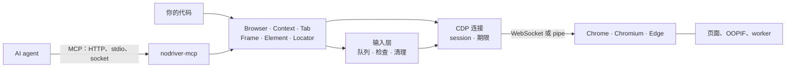
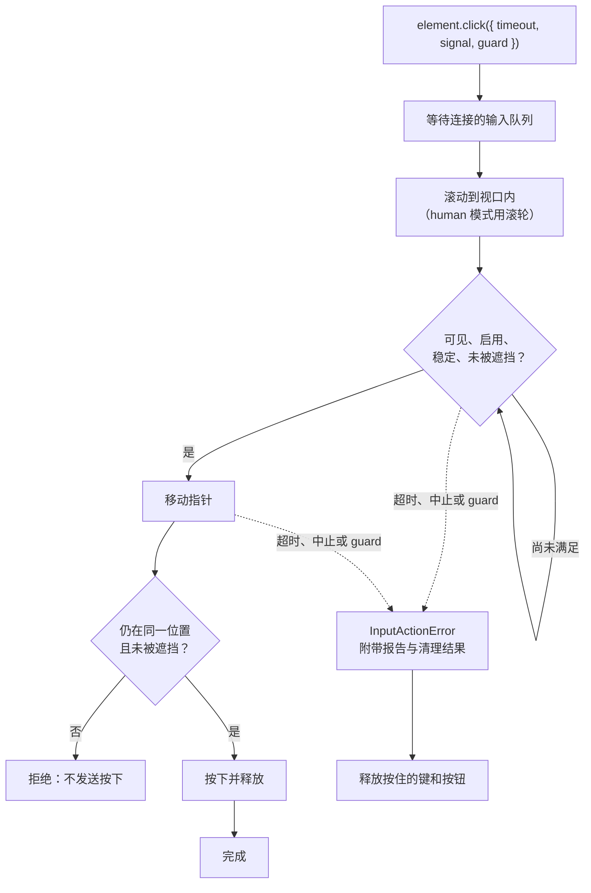
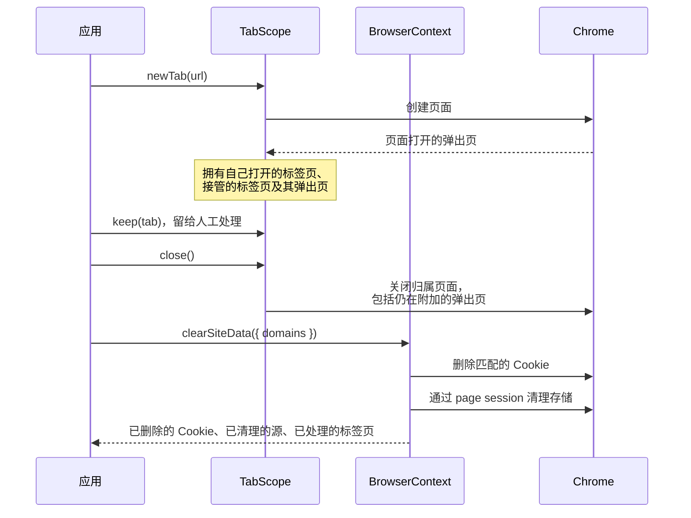
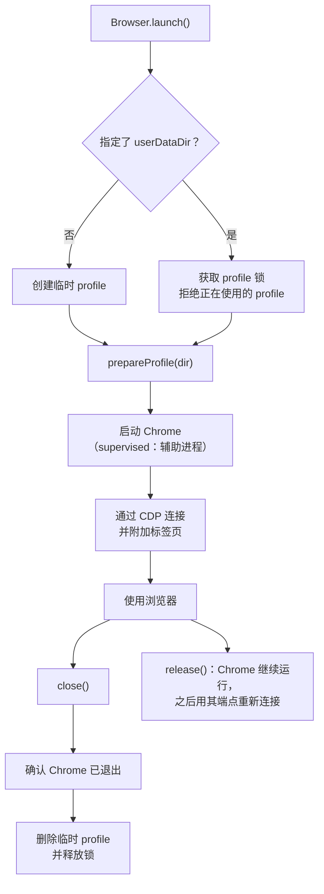

# nodriver-ts

基于 [nodriver](https://github.com/ultrafunkamsterdam/nodriver) 重新设计的 TypeScript 实现：通过 Chrome DevTools Protocol（CDP）自动化 Chrome、Chromium 和 Edge，不使用 WebDriver，也不发送 `Runtime.enable`，并内置面向 agent 的 [Model Context Protocol](https://modelcontextprotocol.io/specification/2026-07-28) 服务。

[English](README.md)

- **安静的 CDP。** 库从不发送 `Runtime.enable`、`Runtime.addBinding`、`Console.enable` 或 `Debugger.enable`，也不会退回到这些命令。它通过 frame 的 document 和 `DOM.resolveNode` 找到主世界，不向页面注入任何内容，Chrome 的 sandbox 和站点隔离保持开启。
- **Frame 与 shadow DOM。** 同进程 iframe 和进程外 iframe（OOPIF，包括嵌套的 OOPIF）各自使用正确的 CDP session。查询会穿透 open 和 closed shadow root。
- **输入。** 点击会等待目标可见、稳定且未被遮挡，动作从不重放。可选的带种子 `human` 策略提供指针轨迹、按键事件打字和滚轮滚动。
- **面向 agent 的 MCP。** 工具通过缩进可访问性快照中稳定的元素引用（`e12`）操作元素，并报告动作引起了什么：导航、新标签页、对话框。HTTP 租约让浏览器状态在多次请求和重连之间保留。Streamable HTTP、stdio 和本地 socket 共用同一套实现。

## 整体结构



你的代码和 MCP 服务使用同一套对象。所有命令都经过同一个连接：连接把命令发往它所属的 browser、page 或 frame session，应用调用方的超时和取消信号，并在 `ProtocolError` 中注明该 session。

> 没有检测不到的自动化框架。nodriver-ts 去除常见的 CDP 和 WebDriver 痕迹，但不保证任何网站都会放行。见[自动化痕迹](#自动化痕迹)。

## 运行要求

- Node.js 24.22.0 或更高版本。
- 本机安装的 Chrome、Chromium 或 Edge。在 Windows、macOS 和 Linux 上会自动查找，包括 `PATH`；否则请设置 `CHROME_PATH` 或 `executablePath`。
- 默认的有界面模式需要显示环境。在服务器和 CI 上请传入 `headless: true`（MCP 服务使用 `--headless`）；在 Linux 上也可以用 `virtualDisplay: true`（`--virtual-display`）让有界面的 Chrome 运行在专属的 Xvfb 服务器上。Linux 上应以普通用户运行并安装 Chrome 所需的共享库：库从不添加 `--no-sandbox`。WSL 上的有界面模式需要 WSLg 或其他显示服务。

支持的平台见 [docs/zh-CN/support.md](docs/zh-CN/support.md)。

## 快速开始

```sh
npm install nodriver-ts
```

```js
import { Browser } from 'nodriver-ts';

await using browser = await Browser.launch({ headless: true }); // 作用域结束时关闭
const tab = await browser.newTab('https://example.com');
console.log(await (await tab.waitForSelector('h1')).text());
await tab.screenshot({ path: 'page.png', fullPage: true });
```

- **会重新渲染的元素。** `tab.locator('#save')` 在每次操作前重新查询，因此单页应用重绘按钮后，点击仍作用于当前的按钮。已经发出的输入绝不重复。
- **页面内的请求。** `tab.fetch('/api/me', { responseType: 'json' })` 用页面的 Cookie、源和代理运行 `fetch()`。超时或中止时，页面中的请求也会被中止。
- **求值。** `tab.evaluate()` 在页面主世界运行，传入 `{ world: 'isolated' }` 则在隔离世界运行。函数会序列化到页面中。
- **Frame。** `tab.frames` 列出所有 frame，包括 OOPIF。查询不会悄悄跨 frame。
- **上下文与代理。** `browser.newContext({ proxy })` 隔离 Cookie 和存储，并支持带认证的 HTTP(S) 与 SOCKS 上游代理。
- **网络。** `tab.network.route()` 拦截并替换请求，`authenticate()` 应答认证质询，`responses` 订阅响应。`Network.enable` 只在订阅响应、调用 `enable()` 或设置请求头、缓存或离线模式时发送。
- **human 输入。** `Browser.launch({ inputPolicy: { mode: 'human' } })` 作用于所有标签页和弹出页，`tab.setInputPolicy()` 只修改单个标签页。它启用可复现的指针轨迹、US 布局字符的按键事件和滚轮滚动；其他文本（如中日韩文字或 emoji）通过 `insertText` 输入。`fill()` 一次性插入替换整个值，`type(text, { replace: true })` 则逐键输入覆盖原值。见[输入](docs/zh-CN/input.md)。
- **现有浏览器。** `Browser.connect({ endpoint })` 附加所有标签页；传入 `attach: 'created'` 时只附加本客户端打开的标签页及其弹出页。此时 `close()` 只断开连接。远程调试端点拥有浏览器的完全控制权，请限制对它的访问。
- **交接。** 以 `detached: true` 和 WebSocket 启动时，Chrome 可以比当前进程活得更久：`browser.release()` 返回之后可重新连接的端点。加上 `supervised: true`，宿主在 release 前退出时由辅助进程结束 Chrome。见[浏览器交接](docs/zh-CN/browser-handoff.md)和[监管启动](docs/zh-CN/lifecycle-ownership-design.md)。
- **原始 session。** `attach: 'none'` 只发现 target，不创建标签页；`attachSession()` 返回生命周期明确的独立 session。见 [原始 session](docs/zh-CN/raw-sessions.md)。
- **诊断。** `trace`（或 `NODRIVER_TRACE=1`）记录每条命令的方法、session、耗时和错误码，从不记录参数或结果。`browser.drain()` 等待晚到的响应，启动失败会报告所处阶段和进程状态。见[启动诊断](docs/zh-CN/startup-diagnostics.md)。
- **不启动 Chrome 的测试。** `nodriver-ts/testing` 提供 `ScriptedChrome`：一个脚本化的 CDP 对端，背后是真实的 Browser、Tab 和 Session 对象。见[测试接口](docs/zh-CN/testing.md)。

完整参考见 [docs/zh-CN/api.md](docs/zh-CN/api.md)，可运行的示例在 [examples/](examples/)。

## 一次操作如何执行

每次点击、悬停、填写和输入都是一个输入动作，只有一个期限。同一连接上的动作依次执行；失败的动作先完成清理，下一个动作才开始。



点击绝不会改到别的位置，也绝不会重发。`setChecked()` 在同一个期限内读取状态、点击控件或其 label，并等待新状态。只有当旧元素在发出任何按下、按键或文本之前就被替换时，`Locator` 才会在新元素上重新执行操作。

## 长期运行的应用

一个服务如果用同一个浏览器完成许多任务，可以把每个任务的页面放进一个作用域，清除某个站点的登录而不影响另一个站点，并在 Chrome 启动前准备好 profile：

```js
import { Browser, updateProfileSettings } from 'nodriver-ts';

await using browser = await Browser.launch({
  userDataDir: 'data/browser-profile',
  inputPolicy: { mode: 'human' },
  // 在本进程持有 profile 锁期间、Chrome 启动之前运行。
  prepareProfile: (dir) =>
    updateProfileSettings(dir, { preferences: { credentials_enable_service: false } }),
});

{
  await using scope = browser.tabScope();
  const tab = await scope.newTab('https://platform.example/tasks');
  // ... 任务打开的弹出页也归作用域所有
} // 关闭该任务的标签页和弹出页，其他标签页保持打开

await browser.defaultContext.clearSiteData({
  domains: ['platform.example'], // admin.example 保持登录
  openTabs: 'blank',
});
```



只要还有标签页显示该站点，或在离开该站点后仍保留其 sessionStorage，`clearSiteData()` 默认就会拒绝执行，因为页面可能保留或重新写回数据；`openTabs: 'close'` 或 `'blank'` 会先处理这些标签页。源按精确值匹配，包括端口；Cookie 按主机名匹配。`prepareProfile` 同时支持临时 profile 和持久 profile；`updateProfileSettings()` 把设置合并进 `Local State` 和 `Preferences`，保留其他键，并回读校验。这项校验只覆盖文件本身，不能说明某个浏览器版本是否遵循该设置。一个持久 profile 同一时间只能供一个浏览器使用；固定 profile 对 Chrome 在 Windows 上的密码检查有哪些影响、哪些不变，见 [Profile](docs/zh-CN/api.md#profile)。

## 浏览器生命周期



## MCP 服务

安装包后会提供 `nodriver-mcp` 命令。stdio MCP 客户端的配置：

```json
{
  "mcpServers": {
    "browser": {
      "command": "npx",
      "args": ["-y", "nodriver-mcp"]
    }
  }
}
```

作为常驻的本地 HTTP 服务：

```sh
export NODRIVER_MCP_TOKEN="$(openssl rand -hex 32)"   # 至少 32 个字符
nodriver-mcp --mcp-transport http --port 3100
# 客户端连接 http://127.0.0.1:3100/mcp，并带上 "Authorization: Bearer $NODRIVER_MCP_TOKEN"
```

- **租约。** HTTP 只监听回环地址。没有 `Browser-Lease-Id` 请求头的请求使用该 token 的 `default` 租约。由字母、数字和 `. _ -` 组成的其他名称在首次使用时创建独立租约，让多个 agent 各自保持浏览器状态。
- **协议版本。** 默认入口要求 MCP 2026-07-28。使用官方 TypeScript 客户端 2.3.1 时，需固定 `versionNegotiation: { mode: { pin: '2026-07-28' } }`。对于 2025-11-25 和 2025-06-18 的客户端，加上 `--mcp-compat`；HTTP 客户端随后连接 `/mcp/compat`。见[通用 Agent 兼容](docs/zh-CN/agent-compatibility.md)和 [Pi](docs/zh-CN/pi.md)。
- **浏览器。** Chrome 在首次 `browser_open` 时启动，使用 `agent` 启动预设：不显示首次运行界面、搜索引擎选择页和崩溃恢复气泡，关闭后台节流，并设置 `--password-store=basic`。在 Linux 上，Chrome 因此用内置密钥而不是系统密钥环加密已保存的密码和 Cookie。

`nodriver-mcp --help` 列出所有参数。常用的有：

- `--headless`、`--virtual-display`、`--user-data-dir`、`--endpoint http://127.0.0.1:9222`、`--proxy URL`
- `--lang`、`--window-size 1280x800`、`--user-agent`
- `--input-policy human`、`--read-only`、`--disable-tool NAME`
- `--upload-dir`、`--download-dir`、`--state-dir`：各自启用对应的文件工具，并限定在该目录内
- `--state-key-env NAME`：用该环境变量中的口令加密 `--state-dir` 中的文件
- `--remote-handoff`（仅限 HTTP）：让用户通过私密的查看链接操作标签页，见[远程人工接管](docs/zh-CN/mcp-http.md#远程人工接管)

默认的 26 个工具：

- **标签页与导航：** `browser_tabs`、`browser_open`、`browser_navigate`、`browser_history`、`browser_close_tab`、`browser_close`
- **观察：** `browser_snapshot`、`browser_find`（CSS、XPath 或文本）、`browser_wait`、`browser_screenshot`、`browser_network`
- **动作：** `browser_click`、`browser_click_at`、`browser_hover`、`browser_drag`、`browser_fill`、`browser_type`、`browser_press_key`、`browser_select`、`browser_check`、`browser_scroll`、`browser_dialog`
- **其他：** `browser_evaluate`、`browser_input_policy`、`browser_environment`、`browser_handoff`（请用户在浏览器窗口中或通过远程查看链接手动完成某一步）

`browser_upload`、`browser_downloads` 和 `browser_storage_state` 只在设置对应目录参数时出现，`browser_handoff_wait` 只在开启 `--remote-handoff` 时出现。

除 `browser_scroll` 和 `browser_dialog` 外，动作工具接受 `waitFor: "auto" | "load" | "none"` 和 `snapshot: true`，并返回发生了什么（`navigated`、`newTabs`、`dialog`、`tabClosed`），agent 不必在每一步后再多查询一次。被 JavaScript 对话框打断的动作立即返回 `pending: true`；用 `browser_dialog` 应答该对话框。

见 [MCP](docs/zh-CN/mcp.md)、[HTTP 接入](docs/zh-CN/mcp-http.md)和 [socket 接入](docs/zh-CN/mcp-socket.md)。

## 自动化痕迹

默认行为：

- 不自动启用 `Runtime`、`Console` 或 `Debugger` 域，不使用 binding，也不在主世界中注入初始化脚本。
- 关闭 Chromium 的 `AutomationControlled` 特性，因此 `navigator.webdriver` 原生为 `false`，不修补任何 getter。
- 无界面模式保留原生 UA。`maskHeadless: true` 会去掉页面 UA、UA-CH 和 Dedicated Worker 中的 HeadlessChrome；Shared Worker、Service Worker 及其请求可能保留原生值。见[差分审计](docs/zh-CN/differential-audit.md)。
- 输入只在标签页不在最前面时才将其置前；按住鼠标键时报告 0.5 的压力，与真实鼠标一致。human 模式还会发送符合 US 布局的成对 keyDown/keyUp，指针从随机位置而不是 (0, 0) 开始。

这些都不是伪装：不伪造字体、WebGL、canvas、音频或硬件，也不解验证码。环境覆盖（时区、locale、UA-CH、视口、地理位置）需要显式启用；见[环境](docs/zh-CN/environment.md)。在 Linux 上，`nativeEnvironment` 改为设置所启动进程的时区和语言；见[原生启动环境](docs/zh-CN/native-environment.md)。[自动化痕迹审计](docs/zh-CN/automation-audit.md)列出了仍可观测的信号。

## 开发

在仓库中，Node 直接运行 TypeScript 源码：

```sh
git clone https://github.com/jaykwok/nodriver-ts.git
cd nodriver-ts
npm ci
npm run check                # 严格类型检查（src 和测试）
npm test                     # 单元测试
npm run test:integration     # 真实 Chrome，覆盖两种 CDP 传输
npm run test:dist            # 构建后对包和 MCP HTTP 做冒烟测试
npm run format:check
```

## 文档

以下为简体中文译本；英文版位于 [docs/](docs/)，内容有出入时以英文版为准。

| 文档                                                               | 内容                                                      |
| ------------------------------------------------------------------ | --------------------------------------------------------- |
| [API](docs/zh-CN/api.md)                                           | 对象、期限、查询、Locator、页面内请求、标签页作用域、存储 |
| [输入](docs/zh-CN/input.md)                                        | human 输入策略、打字、指针检查、取消                      |
| [环境](docs/zh-CN/environment.md)                                  | 环境采样、诊断、显式对齐、WebRTC                          |
| [原生启动环境](docs/zh-CN/native-environment.md)                   | Linux 进程时区与语言、启动检查、通过代理确定时区          |
| [浏览器交接](docs/zh-CN/browser-handoff.md)                        | 分离启动、交接与重连、CDP 事件订阅                        |
| [监管启动](docs/zh-CN/lifecycle-ownership-design.md)               | 进程监管、有界 stderr、显式 release                       |
| [原始 session](docs/zh-CN/raw-sessions.md)                         | 非托管 target、session 生命周期、drain、发送观察          |
| [启动诊断](docs/zh-CN/startup-diagnostics.md)                      | 启动和连接失败的阶段与进程信息                            |
| [自动化痕迹审计](docs/zh-CN/automation-audit.md)                   | 默认协议行为、回归检查、仍可观测的信号                    |
| [差分审计](docs/zh-CN/differential-audit.md)                       | 原生、伪装和显式配置的启动，页面与 Worker                 |
| [MCP](docs/zh-CN/mcp.md)                                           | CLI、工具、引用、页面 JavaScript、嵌入                    |
| [HTTP 接入](docs/zh-CN/mcp-http.md)                                | 租约、认证、限额、资源、人工交互                          |
| [socket 接入](docs/zh-CN/mcp-socket.md)                            | Unix socket / 命名管道服务与客户端                        |
| [通用 Agent 兼容](docs/zh-CN/agent-compatibility.md)               | MCP 2025-11-25 / 2025-06-18 客户端                        |
| [支持范围](docs/zh-CN/support.md)                                  | 平台、能力、限制                                          |
| [性能](docs/zh-CN/performance.md) · [长稳测试](docs/zh-CN/soak.md) | 基准方法与基线、长时间资源测试                            |
| [脚本化测试](docs/zh-CN/testing.md)                                | 用 `ScriptedChrome` 在不启动 Chrome 的情况下测试代码      |
| [上游映射](docs/zh-CN/upstream-api-map.md)                         | nodriver 成员与 TypeScript 对应项                         |
| [API 测试映射](docs/zh-CN/test-map.md)                             | 调用每个公开成员和 MCP 工具的测试（自动生成）             |

变更记录见 [CHANGELOG.md](CHANGELOG.md)。

## 许可

Apache-2.0，见 [LICENSE](LICENSE)。
